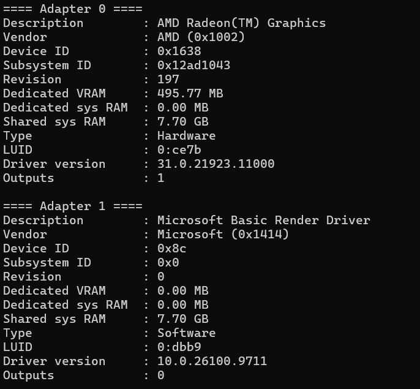

# DirectXProject

DirectX renderer developed step by step as a single project. Each stage of the development adds new functionality on top of the previous one.

## Requirements

- Windows 10 or newer
- Visual Studio with the "Desktop development with C++" workload
- C++20 (MSVC)
- A GPU with Direct3D 12 support

## Build

1. Open the solution in Visual Studio.
2. Select the `x64` platform and the `Release` configuration.
3. Build with `Ctrl+Shift+B`.

The executable is placed in `x64/Release/`. `dxgi.lib` and `d3d12.lib` are linked automatically.

## Features

- GPU adapter enumeration through DXGI: vendor, model, device and subsystem IDs, revision, dedicated video memory, dedicated system memory, shared system memory, driver version, LUID, number of outputs
- Direct3D 12 initialization on the first hardware adapter that supports it (minimum feature level 11_0):
  - `ID3D12Device`
  - `ID3D12CommandQueue` (direct type, no flags)
  - `ID3D12CommandAllocator` (direct type)
  - `ID3D12GraphicsCommandList` (direct type, created with the allocator)
- Every creation step is checked and a failure is reported with its HRESULT

## Usage

The program takes no arguments.

```
DirectXProject.exe
```

## Screenshot



## Project structure

- `DirectXProject/DirectXProject.cpp` - entry point
- `DirectXProject/Renderer.h` / `DirectXProject/Renderer.cpp` - `Renderer` class, the core of the project

## Development history

Each stage is developed in its own branch based on the previous one.

| Branch | Content |
|---|---|
| `lecture-01` | DXGI adapter enumeration |
| `lecture-02` | Direct3D 12 device, command queue, command allocator and command list |

## Releases

Prebuilt binaries are available in the Releases section.
